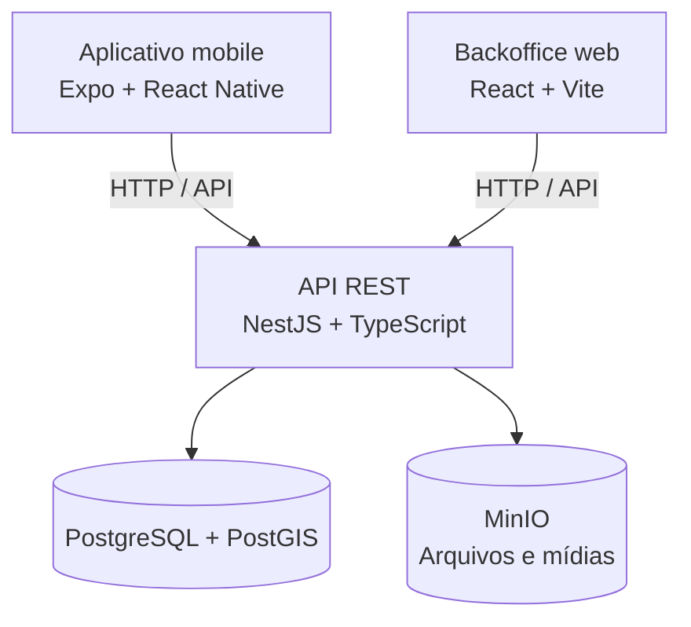

aw<div align="center">

# OnCoopera

### Tecnologia no apoio ao paciente oncológico

**Trabalho de Graduação (TG) — Faculdade de Tecnologia Dom Amaury Castanho (Fatec Itu) · 2026**

Uma solução de saúde digital para apoiar pacientes oncológicos com informação, registro de sintomas e acesso a serviços de apoio.

[Visão geral](#sobre-o-projeto) · [Funcionalidades](#funcionalidades) · [Arquitetura](#arquitetura) · [Execução](#como-executar) · [Equipe](#equipe-e-contexto-acadêmico)

</div>

---

## Sobre o projeto

O **OnCoopera** é um projeto acadêmico desenvolvido como **Trabalho de Graduação (TG)** no curso de **Análise e Desenvolvimento de Sistemas da Faculdade de Tecnologia Dom Amaury Castanho (Fatec Itu)**.

O tratamento oncológico envolve desafios que vão além do atendimento clínico, incluindo o acompanhamento de sintomas, a busca por informações compreensíveis e a identificação de instituições que oferecem suporte. Nesse contexto, o OnCoopera propõe concentrar recursos de apoio em uma experiência digital acessível.

A solução compreende um **aplicativo mobile voltado ao paciente**, um **backoffice web para administração** e uma **API centralizada** que integra os serviços e a persistência dos dados.

> **Aviso:** O OnCoopera é uma ferramenta de apoio e informação. Não substitui consultas, diagnósticos, orientações ou tratamentos realizados por profissionais de saúde.

## Funcionalidades

### Aplicativo mobile — pacientes

| Funcionalidade | Descrição |
| --- | --- |
| Autenticação e perfil | Cadastro, login, recuperação de acesso e gerenciamento de dados do paciente. |
| Artigos informativos | Consulta de conteúdos educativos, com estruturação visual e recursos de leitura. |
| Diário de sintomas | Registro de sintomas e consulta dos registros anteriores, incluindo recursos associados a áudio. |
| Relatórios | Visualização e compartilhamento de informações registradas para acompanhamento. |
| Radar de apoio | Localização de instituições e serviços de apoio por meio de recursos geográficos. |
| Notificações | Comunicação de informações relevantes ao usuário. |
| Acessibilidade | Recursos voltados a tornar o conteúdo e a navegação mais acessíveis. |

### Backoffice web — administradores

| Funcionalidade | Descrição |
| --- | --- |
| Painel administrativo | Visão geral e indicadores relacionados à operação do sistema. |
| Gestão de artigos | Cadastro, edição e publicação de conteúdos informativos. |
| Gestão do radar de apoio | Manutenção de instituições e pontos de apoio apresentados aos pacientes. |
| Gestão de usuários | Administração das informações e dos acessos previstos para os perfis do sistema. |

> As funcionalidades apresentadas descrevem o escopo do projeto. Para detalhes de implementação, limitações e execução de cada módulo, consulte seu repositório específico.

## Arquitetura

O projeto é organizado em três aplicações versionadas separadamente e reunidas neste repositório por **Git Submodules**.



| Componente | Tecnologias principais | Repositório |
| --- | --- | --- |
| Mobile | React Native, Expo, Expo Router, TypeScript e NativeWind | [OnCoopera-Mobile](https://github.com/PortoTimido/OnCoopera-Mobile) |
| Backoffice | React, TypeScript, Vite e Tailwind CSS | [OnCoopera-Backoffice](https://github.com/PortoTimido/OnCoopera-Backoffice) |
| Backend | NestJS, TypeScript, Prisma, Swagger e autenticação JWT | [OnCoopera-Backend](https://github.com/PortoTimido/OnCoopera-Backend) |
| Banco de dados | PostgreSQL e PostGIS | Configurado na infraestrutura |
| Armazenamento | MinIO | Configurado na infraestrutura |
| Infraestrutura | Docker e Docker Compose | Este repositório |

### Estrutura do repositório

```text
OnCoopera/
├── OnCoopera-Backend/       # API REST (submódulo)
├── OnCoopera-Backoffice/    # Painel administrativo (submódulo)
├── OnCoopera-Mobile/        # Aplicativo mobile (submódulo)
├── docker-compose.yml       # Orquestração da infraestrutura
├── init-database.sql        # Inicialização do banco de dados
├── .gitmodules              # Configuração dos submódulos
└── README.md                # Documentação principal
```

## Como executar

### Pré-requisitos

- **Git**, com suporte a submódulos.
- **Docker** e **Docker Compose**, para os serviços conteinerizados.
- **Node.js 24 ou superior** e **npm**, caso deseje executar diretamente o backend e o backoffice, conforme os requisitos declarados nos respectivos `package.json`.
- Ambiente Expo compatível para executar o aplicativo mobile, conforme a documentação de seu repositório.

### 1. Clonar o repositório e os submódulos

```bash
git clone --recurse-submodules https://github.com/PortoTimido/OnCoopera.git
cd OnCoopera
```

Se o repositório já tiver sido clonado sem os submódulos:

```bash
git submodule update --init --recursive
```

### 2. Configurar as variáveis de ambiente

Na raiz do repositório, configure um arquivo `.env` com os valores exigidos por `docker-compose.yml`.

Principais grupos de configuração:

| Grupo | Exemplos de variáveis |
| --- | --- |
| Banco de dados | `POSTGRES_DB`, `POSTGRES_USER`, `POSTGRES_PASSWORD`, `DATABASE_URL` |
| Autenticação | `JWT_ACCESS_SECRET`, `AUTH_TOKEN_HASH_SECRET`, `GOOGLE_WEB_CLIENT_ID` |
| E-mail | `EMAIL_HOST`, `EMAIL_PORT`, `EMAIL_USERNAME`, `EMAIL_PASSWORD` |
| Armazenamento | `MINIO_ROOT_USER`, `MINIO_ROOT_PASSWORD`, `MINIO_BUCKET` |

A lista completa e os valores opcionais estão no arquivo [`docker-compose.yml`](./docker-compose.yml) e na documentação do [backend](https://github.com/PortoTimido/OnCoopera-Backend).

**Importante:** `DATABASE_URL` deve apontar para o serviço `postgres` na rede Docker e utilizar credenciais coerentes com as variáveis do banco. Nunca publique segredos, senhas reais ou arquivos `.env`.

### 3. Iniciar os serviços

```bash
docker compose up -d --build
```

O Compose inicia o PostgreSQL/PostGIS, MinIO, a API NestJS e o backoffice web. As migrações Prisma são executadas no processo de inicialização do contêiner da API.

Para verificar o estado dos serviços:

```bash
docker compose ps
```

Para acompanhar os logs:

```bash
docker compose logs -f api web
```

Para encerrar os contêineres:

```bash
docker compose down
```

Por padrão, o Compose publica a API em `127.0.0.1:3000` e o backoffice em `127.0.0.1:8080`, acessíveis no próprio host. O PostgreSQL e o MinIO permanecem na rede interna do Docker; para acesso externo, é necessária configuração adicional de rede e proxy.

> **Atenção:** o `docker-compose.yml` é voltado à infraestrutura e não executa o aplicativo mobile. Antes de disponibilizar a solução publicamente, revise domínios, TLS, configuração de e-mail, chaves do Google Maps e políticas de segurança.

### 4. Executar o aplicativo mobile

```bash
cd OnCoopera-Mobile
npm install
npm run start
```

Configure a URL da API conforme as instruções do [repositório mobile](https://github.com/PortoTimido/OnCoopera-Mobile). Em dispositivos físicos, `localhost` aponta para o próprio dispositivo, não para o computador que hospeda a API. Recursos nativos, como autenticação Google, podem exigir uma build de desenvolvimento em vez do Expo Go.

## Testes e qualidade

Cada aplicação possui sua própria configuração de testes e validações:

| Módulo | Ferramentas / comandos |
| --- | --- |
| Backend | Japa / Jest; `npm test` |
| Backoffice | Playwright; `npm run test:e2e` |
| Mobile | Jest e Testing Library; `npm test` |

Consulte os READMEs individuais para verificar dependências e configuração do ambiente de testes.

## Privacidade e responsabilidade

O projeto trata de informações potencialmente sensíveis, especialmente dados relacionados à saúde. Seu desenvolvimento considera a **Lei Geral de Proteção de Dados Pessoais (LGPD — Lei nº 13.709/2018)**, a minimização de dados, o controle de acesso e a proteção das informações dos usuários.

O uso da aplicação não substitui o acompanhamento médico. As informações disponibilizadas têm finalidade de apoio e não devem ser utilizadas como diagnóstico ou prescrição.

## Equipe e contexto acadêmico

- **Instituição:** Faculdade de Tecnologia Dom Amaury Castanho (Fatec Itu).
- **Curso:** Análise e Desenvolvimento de Sistemas.
- **Modalidade:** Trabalho de Graduação (TG).
- **Ano:** 2026.
- **Desenvolvimento:** Henrique Andrade Rodrigues e Henrique Garcia Carvalho.
- **Orientação acadêmica:** Mestre Ricardo Roberto Leme.

## Documentação complementar

- [Backend — API e regras de negócio](https://github.com/PortoTimido/OnCoopera-Backend)
- [Backoffice — interface administrativa](https://github.com/PortoTimido/OnCoopera-Backoffice)
- [Mobile — aplicativo para pacientes](https://github.com/PortoTimido/OnCoopera-Mobile)

## Uso acadêmico e licença

Este repositório foi desenvolvido em contexto acadêmico como Trabalho de Graduação. **A disponibilização pública do código não implica, por si só, autorização para redistribuição ou uso comercial.** Consulte os responsáveis pelo projeto antes de reutilizá-lo.

---

<div align="center">

**OnCoopera — tecnologia, informação e apoio durante a jornada oncológica.**

</div>
